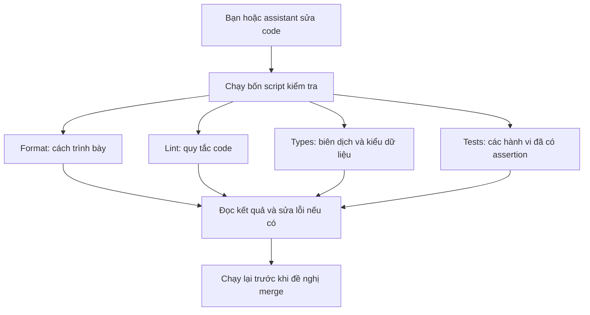

# Giải thích phần 7 — Những gì đã làm và vì sao cần cho PA2

## 1. Bạn đang học phần nào?

**Phần 7 trong hướng dẫn học tương ứng chủ yếu với tiêu chí 3 của rubric PA2: “Một lệnh cho mỗi check”.** Đừng nhầm nó với tiêu chí 7 của rubric là AI-LOG.

Mục tiêu là: sau khi sửa code, bạn có cách kiểm tra tự động, lặp lại được. Sau này CI chạy lại đúng các lệnh ấy trên máy của nền tảng Git hosting.

Ví dụ bạn nhờ assistant thêm một chức năng. Code trông hợp lý nhưng có thể sai kiểu dữ liệu, vi phạm kiến trúc hoặc làm hỏng hành vi đã có. Bốn check cung cấp phản hồi cho từng loại lỗi. Chúng không thay thế việc đọc và hiểu code.

Bài này giải thích các file **đã có trong repository**, không yêu cầu bạn cài lại các công cụ. Bài thực hành tạo lỗi chi tiết nằm ở phần 7.4 của [hướng dẫn PA2](../../knowledge/HUONG_DAN_HOC_VA_LAM_PA2.vi.md). Thư mục `knowledge/` được Git ignore nên link đó chỉ hoạt động khi có tài liệu trên máy.

## 2. Bức tranh tổng thể



Sơ đồ này là quy trình local. Workflow CI và branch protection chưa được triển khai ở bước này.

## 3. Những file đã được tạo hoặc sửa

Các đường dẫn trong bảng được tính từ thư mục gốc repository.

| File | Vai trò |
| --- | --- |
| `scripts/check-format.sh` | Gọi kiểm tra format C# và frontend |
| `scripts/check-lint.sh` | Gọi analyzer C# và Oxlint |
| `scripts/check-types.sh` | Build C# và kiểm tra TypeScript |
| `scripts/check-tests.sh` | Chạy bộ test .NET và xác minh báo cáo |
| `scripts/verify-test-results.mjs` | Chặn trường hợp không có test thật sự chạy/pass |
| `.editorconfig` | Quy tắc encoding, xuống dòng, thụt dòng và analyzer C# |
| `Directory.Build.props` | Bật .NET analyzers cho các project bên dưới |
| `.gitattributes` | Quy định xuống dòng LF khi Git xử lý file văn bản |
| `src/WebFrontend/package.json` | Khai báo các lệnh npm và dependency Prettier |
| `src/WebFrontend/package-lock.json` | Ghi dependency cụ thể để cài lại bằng npm ci |
| `src/WebFrontend/.prettierrc.json` | Quy tắc format frontend |
| `src/WebFrontend/.prettierignore` | Bỏ qua output/dependency và lockfile khi format |
| `src/WebFrontend/.oxlintrc.json` | Bổ sung quy tắc no-debugger |
| `tests/AITravelPlanner.ArchitectureTests/` | Project xUnit và các test kiến trúc |
| `AI_Travel_Planner.sln` | Thêm project test để dotnet test solution tìm thấy |
| `README.md`, `AGENTS.md`, `AI-LOG.md` | Ghi cách chạy, quy tắc cộng tác và kết quả thật |

Các file C# template cũng đã được chỉnh format theo quy tắc mới; đây không phải bổ sung chức năng chuyến đi.

## 4. Hiểu lệnh trước khi chạy

```bash
bash scripts/check-types.sh
```

Đọc là: dùng Bash chạy nội dung file `scripts/check-types.sh`. Nó không tạo file đó.

So sánh:

| Lệnh | Làm gì? |
| --- | --- |
| `mkdir -p scripts` | Tạo thư mục |
| `touch scripts/check-types.sh` | Tạo file rỗng nếu chưa có |
| `bash scripts/check-types.sh` | Thực thi các lệnh đã viết trong file |

Các file hiện tại đã có nội dung. Bạn dùng Git Bash nên không cần `pwsh` để chạy chúng. Gọi bằng `bash file.sh` cũng không đòi hỏi phải chạy `chmod +x` trước.

## 5. Ba dòng chung đầu mỗi script

```bash
#!/usr/bin/env bash
set -euo pipefail
cd "$(dirname "${BASH_SOURCE[0]}")/.."
```

Dòng đầu mô tả shell cần dùng. Dòng thứ hai cấu hình cách xử lý lỗi:

- `-e`: dừng khi một lệnh thông thường trả mã lỗi; có ngoại lệ trong điều kiện và các chuỗi logic.
- `-u`: báo lỗi khi dùng biến chưa khai báo.
- `pipefail`: nếu một lệnh trong pipeline thất bại thì không để kết quả thành công của lệnh cuối che lỗi đó.

Dòng `cd` lấy thư mục chứa script rồi đi lên một cấp, tức gốc repository. Nhờ vậy, các đường dẫn trong script được giải thích thống nhất.

**Exit code** là mã kết quả của lệnh. Sau khi chạy một script, dùng:

```bash
echo $?
```

`0` nghĩa là thành công; khác `0` nghĩa là thất bại. Không cần mọi công cụ dùng cùng một con số lỗi. Phải chạy `echo $?` ngay sau lệnh cần xem vì lệnh khác có thể thay đổi giá trị này.

## 6. Format — Code được trình bày thế nào?

Chạy:

```bash
bash scripts/check-format.sh
```

Script thực hiện tuần tự:

1. Kiểm tra C# whitespace trong `src`.
2. Kiểm tra C# whitespace trong `tests` nếu thư mục tồn tại.
3. Gọi frontend `format:check`, tức `prettier --check .` trong project frontend.

`--verify-no-changes` và `--check` yêu cầu kiểm tra, không tự sửa file. Nếu code chưa đúng format, bạn cần đọc kết quả rồi quyết định sửa.

### Vì sao có Prettier?

Frontend chứa TypeScript, TSX, CSS, JSON và HTML. Prettier giúp trình bày các file đó theo quy tắc nhất quán. Đã thêm Prettier **3.9.5** vào devDependencies, dùng phiên bản cố định để giảm khác biệt giữa các máy.

Ví dụ cấu hình hiện tại:

```json
{
  "semi": false,
  "singleQuote": true,
  "trailingComma": "all"
}
```

Nghĩa là ưu tiên không có dấu chấm phẩy, dùng dấu nháy đơn khi phù hợp và dấu phẩy cuối ở vị trí được hỗ trợ. Formatter vẫn áp dụng quy tắc cú pháp riêng cho các định dạng như JSON.

`.prettierignore` bỏ qua `node_modules/`, `dist/` và `package-lock.json`. Dependency/output không phải nơi bạn cần tự chỉnh format; lockfile để npm quản lý.

### Khi nào chạy lệnh sửa?

```bash
npm --prefix src/WebFrontend run format:write
dotnet format whitespace src --folder
dotnet format whitespace tests --folder
```

Các lệnh này **sửa file**, khác với các check. Đọc `git diff` sau khi chạy. C# hiện kiểm tra whitespace theo folder; đây không phải toàn bộ quy tắc semantic/style của C#, những quy tắc khác được analyzer xử lý tùy cấu hình.

## 7. Lint — Có cách viết code đáng ngờ không?

Chạy:

```bash
bash scripts/check-lint.sh
```

Phía C#, script build với analyzer và `--warnaserror`. Warning được nâng thành lỗi nên không thể bỏ qua chỉ vì compiler vẫn tạo được DLL.

`Directory.Build.props` bật analyzers và đặt `AnalysisLevel` là `latest`, tương ứng các quy tắc do SDK đang dùng cung cấp. `.editorconfig` đặt CA2200 thành warning. Một ví dụ bị bắt là:

```csharp
catch (Exception exception)
{
    throw exception;
}
```

Analyzer cảnh báo việc ném lại bằng `throw exception` làm thay đổi thông tin stack. Trong trường hợp muốn ném lại exception đang xử lý, dùng `throw;`. Đây là lỗi về cách viết code, không phải sai kiểu dữ liệu.

Frontend tiếp tục dùng **Oxlint đã có**, không thay bằng ESLint. Lệnh npm hiện là `oxlint --deny-warnings`. Cấu hình thêm `no-debugger: error`; vì vậy code chứa `debugger` bị phát hiện dù cú pháp ấy vẫn hợp lệ với TypeScript.

Lint chỉ kiểm tra các quy tắc đang bật, không bảo đảm tìm mọi bug.

## 8. Types — Code có biên dịch được và dùng đúng kiểu không?

Chạy:

```bash
bash scripts/check-types.sh
```

Backend được build ở cấu hình Release. Frontend chạy `tsc -b --pretty false` qua npm script `typecheck`.

Ví dụ:

```typescript
export const budget: number = '1000000'
```

`number` yêu cầu một số nhưng giá trị trên là chuỗi, nên TypeScript phải báo lỗi. Đổi thành `1000000` là sửa kiểu; ép qua `any` chỉ để làm xanh sẽ làm yếu kiểm tra.

`npm run build` frontend trước đây vừa chạy TypeScript vừa bundle bằng Vite. Tách `typecheck` giúp biết lỗi thuộc kiểm tra kiểu và không cần đóng gói ứng dụng ở mỗi lần check.

Backend build xuất hiện ở cả lint và types vì compiler và analyzers có thể cùng chạy trong quá trình build. Đây là sự trùng công việc chấp nhận được ở giai đoạn học. Các cờ `--disable-build-servers -m:1 -p:UseSharedCompilation=false` điều chỉnh cách chạy để giảm phụ thuộc compiler server trong môi trường công cụ, không bỏ qua kiểm tra.

## 9. Tests — Chương trình có giữ những quy tắc đã viết thành assertion không?

Chạy:

```bash
bash scripts/check-tests.sh
```

### xUnit và các package liên quan

Project test target .NET 10, đã được thêm vào solution. Ba package là:

| Package | Vai trò trong bộ test |
| --- | --- |
| xunit 2.9.3 | Cung cấp attribute và assertion để viết test |
| xunit.runner.visualstudio 3.1.4 | Giúp hạ tầng VSTest phát hiện và chạy xUnit tests |
| Microsoft.NET.Test.Sdk 17.14.1 | Cung cấp tích hợp test với dotnet test |

Chưa thêm coverage tool vì mục tiêu hiện tại là test chạy được và bắt lỗi có ý nghĩa. Coverage có thể học sau.

### Sáu test hiện có kiểm tra gì?

Mở [DependencyRulesTests.cs](../../tests/AITravelPlanner.ArchitectureTests/DependencyRulesTests.cs).

| Case | Quy tắc |
| --- | --- |
| 1 | Domain không khai báo ProjectReference tới project khác |
| 2 | Application chỉ được tham chiếu Domain |
| 3 | Infrastructure chỉ được tham chiếu Application và Domain |
| 4 | WebApi chỉ được tham chiếu Application và Infrastructure |
| 5 | Domain không khai báo FrameworkReference |
| 6 | Application không khai báo FrameworkReference |

Hai case cuối chủ động yêu cầu phần lõi không có FrameworkReference nào. Nó chặn ví dụ thêm ASP.NET Core vào Domain; test hiện tại không lọc riêng tên framework web.

Các test đầu mô tả **những tham chiếu được phép**, không bắt buộc phải có đủ mọi tham chiếu. Chúng cũng kiểm tra cả khai báo reference có điều kiện.

### Vì sao chỉ hai phương thức mà có sáu case?

```csharp
[Theory]
[InlineData("Domain")]
[InlineData("Application")]
public void Core_layers_do_not_reference_web_frameworks(string layer)
```

`Theory` cho chạy cùng logic với nhiều bộ dữ liệu. Mỗi `InlineData` tạo một case: một lần cho Domain, một lần cho Application. Phương thức còn lại có bốn bộ dữ liệu, tổng cộng sáu.

### Đọc một test theo Arrange — Act — Assert

Với test cấm framework ở phần lõi:

1. **Arrange:** tìm repository và đọc file `.csproj` của tầng đang kiểm tra.
2. **Act:** lấy các phần tử XML tên `FrameworkReference`.
3. **Assert:** `Assert.Empty(frameworks)` yêu cầu danh sách rỗng; nếu có một phần tử thì test fail.

Test đầu dùng `Assert.Contains(reference, allowed)` để kiểm tra từng tên project tham chiếu thuộc danh sách được phép. Dấu phân cách đường dẫn được chuẩn hóa để đọc được `.csproj` trên cả Windows và Linux.

`LoadProject` đi lên từ thư mục assembly test cho đến khi thấy solution, rồi mở file nguồn tương ứng. Vì vậy bộ test này cần checkout có source; không chỉ copy DLL test sang một thư mục bất kỳ rồi chạy.

**Giới hạn:** đây là kiểm tra khai báo trong `.csproj`, không phân tích tất cả thư viện bắc cầu, mọi assembly, mọi file import hoặc hành vi runtime. Sáu test pass không có nghĩa toàn bộ kiến trúc hay nghiệp vụ đã đúng.

## 10. Vì sao test script còn cần kiểm tra TRX?

Đôi khi một lệnh không chạy test nào vẫn có thể kết thúc mà không thể hiện đúng điều bạn mong đợi. Vì vậy script kiểm tra thêm kết quả thực thi.

Quy trình trong file:

1. Từ chối nếu không có test project dưới `tests`.
2. Tạo thư mục kết quả mới bằng `mktemp` dưới `.artifacts/test-results/`.
3. Chạy `dotnet test` với `--logger trx` để xuất báo cáo.
4. Nếu dotnet test lỗi, script dừng.
5. Nếu lệnh thành công, gọi `verify-test-results.mjs` để kiểm tra báo cáo.

TRX là báo cáo XML. Helper đọc các bộ đếm `total`, `executed`, `passed`. Mỗi báo cáo phải có ít nhất một test và toàn bộ số test phải được thực thi/pass. Không có báo cáo, 0 test hoặc test bị bỏ qua đều không được coi là thành công theo chính sách hiện tại.

Node.js được dùng để chạy helper vì frontend đã cần Node; không thêm thư viện XML bên ngoài. Helper đọc phần Counters theo cấu trúc TRX hiện dùng, không phải trình phân tích XML tổng quát. Khi đổi test runner hoặc định dạng báo cáo, cần xem lại nó.

Thư mục mới mỗi lần chạy giúp kết quả cũ không che việc lần này không tạo report. `.artifacts/` đã được Git ignore; bạn không cần commit file báo cáo local.

## 11. Vì sao thêm .editorconfig và .gitattributes?

Hai file phục vụ hai công việc khác nhau:

- `.editorconfig`: hướng dẫn editor/công cụ về UTF-8, LF, indentation và một số mức diagnostic C#.
- `.gitattributes`: hướng dẫn Git xử lý nội dung văn bản và line ending khi checkout/commit.

Windows thường gặp CRLF trong khi Bash thường cần LF để chạy script ổn định. Quy định thống nhất giúp giảm lỗi như ký tự `\r` hoặc thông báo `bad interpreter`. Editor có hỗ trợ thì đọc `.editorconfig`; bản thân file này không tự chạy check. Git attributes cũng không thay thế formatter.

## 12. Đã kiểm chứng những gì?

Theo các lần chạy đã ghi trong AI-LOG, các **lệnh con** được chạy qua PowerShell:

| Kiểm tra | Kết quả đã quan sát |
| --- | --- |
| Prettier check | Pass trên baseline |
| Oxlint | Pass trên baseline |
| TypeScript | Pass trên baseline |
| C# build warnings-as-errors | Pass, 0 warning và 0 error ở lần cuối |
| C# whitespace src/tests | Pass |
| xUnit | 6 pass, 0 fail, 0 skipped |
| Helper TRX | Xác nhận sáu case thực thi/pass |

Các thí nghiệm có chủ ý cũng đã được thực hiện:

- File frontend sai format làm Prettier fail.
- `debugger` làm Oxlint fail.
- Gán chuỗi vào number làm TypeScript fail.
- `throw exception` làm analyzer CA2200 fail.
- Thêm FrameworkReference ASP.NET Core vào Domain làm test kiến trúc fail. Giữ nguyên test và khôi phục project thì sáu case pass lại.

Các fixture lỗi đã được dọn hoặc thay đổi thử nghiệm đã được khôi phục. Đây là thí nghiệm local, không phải sự cố production hay bằng chứng PR bị chặn.

**Chưa xác minh trọn bốn script trong Git Bash của công cụ:** Bash bị chặn với Win32 error 5 trong môi trường đó. Các lệnh con thành công không đủ để khẳng định toàn bộ thao tác shell đã được chạy. Bạn cần chạy lại bốn script trong Git Bash đang dùng.

Việc cài dependency cũng gặp giới hạn mạng: Prettier được cài từ tarball có trong cache, xUnit restore từ cache NuGet. Package/lockfile cuối cùng không phụ thuộc đường dẫn tarball riêng trên máy. Bản clone mới vẫn cần truy cập nguồn package hoặc cache phù hợp.

## 13. Bạn nên tự làm gì tiếp theo?

Từ gốc repository, nếu đã có dependency từ phiên làm việc hiện tại thì chạy từng check. Với clone mới, trước hết chạy:

```bash
dotnet restore AI_Travel_Planner.sln
npm --prefix src/WebFrontend ci
```

Sau đó thực hiện lần lượt:

```bash
bash scripts/check-format.sh
echo $?
```

```bash
bash scripts/check-lint.sh
echo $?
```

```bash
bash scripts/check-types.sh
echo $?
```

```bash
bash scripts/check-tests.sh
echo $?
```

Đọc output, không chỉ đọc con số cuối. Nếu script dừng ở check C# đầu tiên thì chưa thể kết luận frontend đã được kiểm tra.

Sau khi baseline xanh, làm từng bài tạo lỗi ở phần 7.4, chỉ một lỗi mỗi lần, sửa lại rồi kiểm tra. Đừng dùng lệnh reset/clean toàn bộ để dọn vì bạn có thể mất code chưa commit. Ghi kết quả thật vào AI-LOG; không ghi mình đã chạy nếu chỉ mới đọc hướng dẫn.

## 14. Phần này đóng góp gì vào hoàn thành PA2?

| Yêu cầu | Tình trạng sau phần 7 |
| --- | --- |
| Có một lệnh cho format, lint, types, tests | Đã tạo |
| Có công cụ format frontend và test .NET | Đã thêm |
| Lệnh con có thể pass và phát hiện vi phạm | Đã kiểm chứng local |
| Chạy trọn script trong Git Bash của bạn | Cần bạn xác nhận |
| README mô tả cách chạy | Đã cập nhật |
| Clone sạch làm theo README chạy được | Chưa thử |
| CI dùng đúng các lệnh local | Chưa triển khai |
| Required checks chặn merge | Chưa cấu hình; thuộc tiêu chí 4 |
| Contract endpoint và contract test HTTP | Chưa triển khai; thuộc tiêu chí 5–6 |

Để hoàn tất tiêu chí 3 theo mức đầy đủ, cần kiểm chứng khả năng chạy lại từ clone sạch và cho CI chạy cùng các lệnh, bên cạnh việc chạy local. Khi CI đã có, tiêu chí 4 còn yêu cầu cấu hình bắt buộc check và chứng minh một PR lỗi bị chặn.

Test kiến trúc là bộ test đầu tiên có ích cho nền tảng dự án. Nó không thay thế các test như API trả đúng Problem Details, phân trang đúng hoặc không chia sẻ plan trước Save. Những test ấy sẽ được thêm cùng chức năng và contract tương ứng.

## 15. Câu hỏi để kiểm tra bạn đã hiểu

1. Vì sao file `.sh` rỗng chạy không báo lỗi nhưng chưa phải quality check?
2. Vì sao format pass không chứng minh ngân sách chuyến đi được tính đúng?
3. Vì sao `debugger` có thể qua type check nhưng bị lint chặn?
4. Vì sao hai phương thức Theory có thể tạo sáu test case?
5. Nếu dotnet test không tạo report, helper phải làm gì?
6. Nếu test kiến trúc bắt một phụ thuộc sai, bạn nên sửa project hay bỏ assertion?
7. Local xanh, CI xanh và PR được phép merge là ba trạng thái khác nhau thế nào?

Nếu còn khó hiểu, hãy chọn một câu hỏi và mở file tương ứng trong repository để đọc cùng assistant. Chưa cần chuyển sang toàn bộ CI hoặc chức năng AI trong cùng một buổi.
